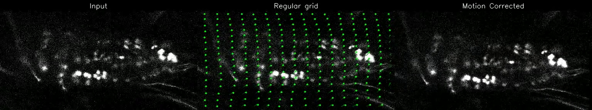
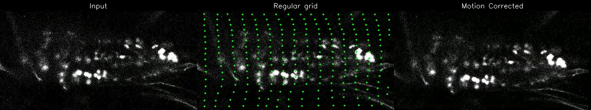
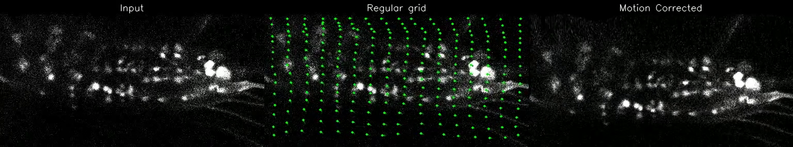

# CoReg

Motion correction for in vivo calcium imaging. Point-based tracking (CoTracker) combined with sparse-to-dense warping — a GUI, a benchmark CLI, self-supervised finetuning, and analysis tools.

<p align="center">
  <br><sub>t = 2 s</sub><br>
  <br><sub>t = 5 s</sub><br>
  <br><sub>t = 8 s</sub>
</p>
<p align="center"><sub>
Input &middot; tracked points (CoReg) &middot; motion-corrected output, at three timestamps of a
10 s, two-photon calcium recording. Full video and more examples on the
<a href="https://ankilab.github.io/CoReg/">project page</a>.
</sub></p>

---

## Repository structure

```
src/CoReg/      # Core package: GUI, benchmark CLIs, CoTracker pipeline, baseline-method wrappers
    cotracker/  # Vendored Meta CoTracker (own license: CC BY-NC 4.0, see cotracker/LICENSE)
    utils/      # Tracking/warping, data I/O, baseline-method wrappers (NoRMCorre, PyFlowReg, ANTs, LDDMM)
    train/      # Self-supervised test-time adaptation of CoTracker (see "Finetuning" below)
analysis/       # Secondary tooling: metric recomputation, interactive cell-annotation/viewer GUIs
napari-coreg/   # Separate, independently installable napari plugin -- see napari-coreg/README.md
docs/           # Project landing page (GitHub Pages)
```

---

## Installation

Requirements: Python 3.10+, CUDA-capable GPU recommended.

```bash
git clone https://github.com/neuluna/registration_gui.git
cd registration_gui

pip install torch torchvision --index-url https://download.pytorch.org/whl/cu124  # adjust to your driver
pip install -e .
```

---

## GUI

```bash
coreg-gui
```

Load a file, select a point preset, run registration. Supported formats:
`.avi`, `.mp4`, `.tif`, `.tiff`, `.h5`, `.hdf5`.

---

## napari plugin

A separate, independently installable napari widget around the same
CoTracker pipeline (same seed-point presets, same `utils.cotracker_pipeline`
core) -- deliberately its own package so napari's Qt backend never shares
an environment with this package's PyQt6. See
[`napari-coreg/README.md`](napari-coreg/README.md) for install and usage.

---

## Benchmark CLI

CoTracker presets:
```bash
coreg-cli --folder /path/to/videos --output-dir /path/to/out --run-name my_run --num-frames 50 --save-videos
```

Baseline methods (NoRMCorre, pyflowreg, ANTs, LDDMM):
```bash
coreg-baseline --folder /path/to/videos --methods normcorre_pwrigid pyflowreg lddmm ants \
               --output-dir /path/to/out --run-name baseline_run --num-frames 50
```

Output, under `<output-dir>/<run-name>/`:
- `benchmark_cotracker.csv` (coreg-cli) / `benchmark_baseline.csv` (coreg-baseline) — one row per video × preset/method (`--output-csv` to override)
- `<same name>_perframe.csv` — one row per video × preset/method × frame
- `config.json` — run parameters
- Per-video subdirectories with registered videos as gzip-compressed HDF5 (`--save-videos`)

---

## Finetuning

Test-time-adapts CoTracker to your own videos via a self-supervised
forward-backward cycle-consistency loss -- no manual point-track labels
needed:

```bash
# Single clip
python -m train.run_adapt --input /path/to/clip.tif --out-dir /path/to/output

# Multiple clips (adaptation generalizes across all of them)
python -m train.run_adapt --input-dir /path/to/videos --out-dir /path/to/output
```

Writes `adapted.pt` (loadable via `--checkpoint` on `coreg-cli`/`coreg-gui`),
`training_curves.png`, and before/after held-out comparisons. See
`python -m train.run_adapt --help` for subset/step/module options.

Compare checkpoints (baseline vs. finetuned) on real videos, and recompute
registration-quality metrics from their tracks:

```bash
python -m train.compare_checkpoints --input-dir /path/to/videos --out-dir /path/to/results \
    --checkpoints my_run=/path/to/output/adapted.pt

python -m train.compute_correction_metrics --input-dir /path/to/videos \
    --tracks-dir /path/to/results/tracks --out-dir /path/to/results
```

---

## Analysis

Recompute metrics from already-saved registered videos, without rerunning
registration:

```bash
# Independent per-video scoring
python analysis/metrics/compute_video_metrics.py --root /path/to/output_dir --output benchmark_recomputed.csv

# Cross-method comparison, one shared border-crop margin per clip
python analysis/metrics/compute_comparison_metrics.py \
    --root /path/to/cotracker_out /path/to/baseline_out \
    --output benchmark_compare.csv
```

Interactive tools (PyQt6/pyqtgraph, run standalone or with a file-picker):

```bash
python analysis/annotation/cell_activity.py --files a.h5 b.h5 c.tiff     # ΔF/F annotation
python analysis/annotation/cell_area.py --files a.h5 b.h5 c.tiff         # area/size annotation
python analysis/annotation/microviewer.py --tiff-dir /path/to/<stem>/tiff  # registered-stack viewer
python analysis/annotation/overlay_viewer.py --files a.h5 b.h5 c.tiff --gt-file gt.h5  # multi-channel overlay
```

Full option sets: each script's `--help` / module docstring.

---

## Acknowledgements

- [CoTracker](https://github.com/facebookresearch/co-tracker) — Meta Research
- [ANTsPy](https://github.com/ANTsX/ANTsPy)
- [NoRMCorre / jnormcorre](https://github.com/flatironinstitute/NoRMCorre)
- [pyflowreg](https://github.com/neuropil/pyflowreg)
- [torch-lddmm](https://github.com/brianlee324/torch-lddmm) — Brian Lee (`src/CoReg/utils/lddmm_wrapper.py`, adapted)

## Citation

t.b.d.

## License

MIT License (`LICENSE`), except `src/CoReg/cotracker/` (vendored
CoTracker source, Meta), licensed separately under CC BY-NC 4.0,
non-commercial use only — see `src/CoReg/cotracker/LICENSE` and `NOTICE`.
Commercial use requires excluding or replacing that directory.
